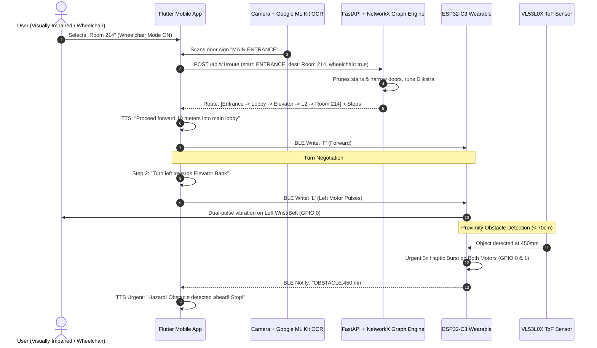

# NAVIA: Accessible Indoor Navigation & Tactile Haptic Wearable

[](https://fastapi.tiangolo.com)
[](https://fastapi.tiangolo.com)
[](https://networkx.org)
[](https://flutter.dev)
[](https://espressif.com)
[](https://docker.com)

**NAVIA** is an end-to-end, high-precision indoor navigation platform designed for visually impaired and wheelchair users. NAVIA fuses **computer vision sign recognition (Google ML Kit OCR)** on mobile devices, **accessibility-constrained graph pathfinding (FastAPI + NetworkX)** in the cloud, and **dual-motor directional haptics with Time-of-Flight obstacle sensing (ESP32-C3 + VL53L0X)** on a tactile wrist/belt wearable.

---

## 1. System Architecture

The following diagram illustrates how the three tiers communicate synchronously and asynchronously:



---

## 2. Repository Structure

```
NAVIA/
├── backend/                        # Python FastAPI Indoor Graph Router
│   ├── app/
│   │   ├── __init__.py
│   │   ├── main.py                 # FastAPI endpoints (/health, /nodes, /route)
│   │   ├── models.py               # Pydantic schemas (UserProfile, RouteRequest, Steps)
│   │   ├── graph_engine.py         # NetworkX accessibility pruning & turn calculations
│   │   └── data/
│   │       └── building_mock.json  # Multi-story facility nodes & edge geometry
│   ├── tests/
│   │   ├── __init__.py
│   │   └── test_router.py          # Pytest suite verifying routing & accessibility
│   ├── requirements.txt
│   └── pytest.ini
│
├── mobile/                         # Flutter Cross-Platform Client
│   ├── pubspec.yaml                # FlutterBluePlus, ML Kit OCR, Camera, FlutterTTS
│   ├── android/app/src/main/
│   │   └── AndroidManifest.xml     # BLE, Camera & Location runtime permissions
│   └── lib/
│       ├── main.dart               # Theme and app initialization
│       ├── models/
│       │   └── navigation_models.dart
│       ├── services/
│       │   ├── api_service.dart    # HTTP routing client & offline fallback simulation
│       │   ├── ble_service.dart    # BLE GATT manager for 'NAVIA-Wearable'
│       │   └── tts_service.dart    # Vocal guidance and hazard interruption
│       ├── widgets/
│       │   ├── direction_hud.dart  # High-contrast turn HUD & proximity alert card
│       │   └── camera_ocr_overlay.dart # Viewfinder targeting reticle & sign badges
│       └── screens/
│           ├── navigation_screen.dart # Core screen: OCR + Voice + Haptic sync
│           └── ble_setup_screen.dart  # Device discovery & manual haptic tests
│
├── firmware/                       # ESP32-C3 SuperMini Embedded Firmware
│   ├── platformio.ini              # PlatformIO environment (pololu/VL53L0X)
│   ├── README.md                   # NPN transistor schematics & wiring specifications
│   ├── include/
│   │   └── config.h                # Hardware pin definitions & BLE UUIDs
│   └── src/
│       └── main.cpp                # Non-blocking BLE GATT server & ToF polling
│
├── deploy/                         # Production Deployment & Containers
│   ├── Dockerfile                  # Multi-stage hardened Python 3.11 image
│   └── docker-compose.yml          # Backend service orchestration & health checks
│
└── README.md                       # Master Architecture & Setup Guide
```

---

## 3. Module Details & Quickstart

### Module 1: Python FastAPI Graph Engine (`/backend`)

The backend models the indoor physical plant as a multi-floor weighted undirected graph.

#### Core Capabilities:
1. **Dynamic Accessibility Pruning**: When `wheelchair_user: true` or `avoid_stairs: true`, edges flagged with `has_stairs` are removed before pathfinding. Edges with `width_meters < user_profile.min_door_width` are also pruned.
2. **Deterministic Fallbacks**: Elevator banks (`L1_ELEVATOR` <-> `L2_ELEVATOR`) provide seamless vertical transport for mobility-restricted users.
3. **Turn Vector Synthesis**: Computes 2D heading changes across consecutive nodes using planar cross/dot products:
   - $\theta > 35^\circ \rightarrow$ **LEFT** (BLE Command `'L'`)
   - $\theta < -35^\circ \rightarrow$ **RIGHT** (BLE Command `'R'`)
   - $-35^\circ \le \theta \le 35^\circ \rightarrow$ **STRAIGHT** (BLE Command `'F'`)
   - Arrival $\rightarrow$ **ARRIVE** (BLE Command `'S'`)

#### Run Backend Locally:
```bash
cd backend
python -m pip install -r requirements.txt
uvicorn app.main:app --host 0.0.0.0 --port 8000 --reload
```

#### Run Test Suite:
```bash
cd backend
python -m pytest
```

---

### Module 2: Flutter Cross-Platform Mobile App (`/mobile`)

The mobile app acts as the sensor fusion hub for the visually impaired user.

#### Key Features:
- **Google ML Kit OCR**: Real-time sign recognition (e.g., scanning "Room 214" or "Elevator 1") anchors the user's position when GPS is unavailable indoors.
- **Flutter Blue Plus (BLE)**: Scans for peripheral `NAVIA-Wearable`, pairs, and dispatches command bytes:
  - `'L'`: Left motor pulse sequence
  - `'R'`: Right motor pulse sequence
  - `'S'`: Dual-motor emergency stop pulse sequence
- **Continuous ToF Proximity Ingestion**: Subscribes to the ESP32 TX characteristic (`beb5483f-...`). When the wearable detects an obstacle $<70\text{ cm}$, the app triggers an immediate audio announcement: *"Hazard alert! Obstacle detected within 70 centimeters. Stop!"*.
- **High-Contrast Accessible UI**: Giant direction icons, high-contrast dark palette (`#0F172A`, `#1E293B`, `#38BDF8`), and tactile buttons.

#### Run Flutter App:
```bash
cd mobile
flutter pub get
flutter run
```

---

### Module 3: ESP32-C3 Wearable Firmware (`/firmware`)

The wearable uses an **ESP32-C3 SuperMini** (RISC-V 32-bit single-core MCU) featuring integrated BLE 5.0.

#### Hardware Pinout:
- **GPIO 0**: Left Haptic Vibration Motor (via NPN Transistor Base)
- **GPIO 1**: Right Haptic Vibration Motor (via NPN Transistor Base)
- **GPIO 7**: I2C SDA (VL53L0X Time-of-Flight Sensor)
- **GPIO 6**: I2C SCL (VL53L0X Time-of-Flight Sensor)

#### NPN Transistor Switching Logic:
Vibration coin motors draw up to 100mA, exceeding the ESP32-C3's 20mA GPIO threshold. Each motor is switched using an NPN transistor (e.g., 2N2222 or SS8050):
- Microcontroller GPIO $\rightarrow$ $1\text{ k}\Omega$ resistor $\rightarrow$ Transistor Base
- Motor connected between $+3.3\text{V}/+5\text{V}$ and Transistor Collector
- Flyback diode ($1\text{N}4148$) across motor leads protects against inductive spikes
- Transistor Emitter connected directly to GND

#### Flash Firmware via PlatformIO:
```bash
cd firmware
pio run --target upload
pio device monitor -b 115200
```

---

### Module 4: Production Deployment (`/deploy`)

The backend is packaged using a **multi-stage Docker build** (non-root execution, minimal attack surface):

#### Launch Container Stack:
```bash
cd deploy
docker compose up -d --build
```

#### Health Check:
```bash
curl http://localhost:8000/health
```
Response:
```json
{
  "status": "healthy",
  "service": "NAVIA-Backend",
  "version": "1.0.0",
  "building_loaded": "campus_med_center"
}
```

---

## 4. API Specification & Sample Payloads

### POST `/api/v1/route`

#### Request Payload:
```json
{
  "building_id": "campus_med_center",
  "start_node_id": "MAIN ENTRANCE",
  "destination_label": "Room 214",
  "user_profile": {
    "wheelchair_user": true,
    "visually_impaired": true,
    "min_door_width": 0.9,
    "avoid_stairs": true,
    "walking_speed_mps": 0.9
  }
}
```

#### Response Payload:
```json
{
  "building_id": "campus_med_center",
  "start_node_id": "L1_ENTRANCE",
  "destination_node_id": "L2_ROOM_214",
  "destination_label": "Room 214 - Radiology Lab",
  "total_distance_meters": 54.0,
  "estimated_time_seconds": 60,
  "accessible": true,
  "route_nodes": [
    "L1_ENTRANCE",
    "L1_LOBBY",
    "L1_ELEVATOR",
    "L2_ELEVATOR",
    "L2_LOBBY",
    "L2_CORR_E",
    "L2_ROOM_214"
  ],
  "steps": [
    {
      "step_index": 0,
      "from_node": "L1_ENTRANCE",
      "to_node": "L1_LOBBY",
      "instruction": "Proceed forward 10.0 meters towards Lobby Information Desk.",
      "turn_type": "STRAIGHT",
      "ble_command": "F",
      "distance_meters": 10.0,
      "floor": 1,
      "landmark_hint": "Lobby Information Desk"
    },
    {
      "step_index": 1,
      "from_node": "L1_LOBBY",
      "to_node": "L1_ELEVATOR",
      "instruction": "Turn right and walk 16.0 meters towards Elevator Bank Level 1.",
      "turn_type": "RIGHT",
      "ble_command": "R",
      "distance_meters": 16.0,
      "floor": 1,
      "landmark_hint": "Elevator Bank Level 1"
    },
    {
      "step_index": 2,
      "from_node": "L1_ELEVATOR",
      "to_node": "L2_ELEVATOR",
      "instruction": "Take the elevator up to Floor 2.",
      "turn_type": "ELEVATOR_UP",
      "ble_command": "F",
      "distance_meters": 4.0,
      "floor": 1,
      "landmark_hint": "Elevator Bank Level 2"
    },
    {
      "step_index": 3,
      "from_node": "L2_ELEVATOR",
      "to_node": "L2_LOBBY",
      "instruction": "Continue straight for 16.0 meters towards Level 2 Central Hall.",
      "turn_type": "STRAIGHT",
      "ble_command": "F",
      "distance_meters": 16.0,
      "floor": 2,
      "landmark_hint": "Level 2 Central Hall"
    },
    {
      "step_index": 4,
      "from_node": "L2_LOBBY",
      "to_node": "L2_CORR_E",
      "instruction": "Turn right and walk 10.0 meters towards East Corridor Level 2.",
      "turn_type": "RIGHT",
      "ble_command": "R",
      "distance_meters": 10.0,
      "floor": 2,
      "landmark_hint": "East Corridor Level 2"
    },
    {
      "step_index": 5,
      "from_node": "L2_CORR_E",
      "to_node": "L2_ROOM_214",
      "instruction": "Turn left and walk 8.0 meters towards Room 214 - Radiology Lab.",
      "turn_type": "LEFT",
      "ble_command": "L",
      "distance_meters": 8.0,
      "floor": 2,
      "landmark_hint": "Room 214 - Radiology Lab"
    },
    {
      "step_index": 6,
      "from_node": "L2_ROOM_214",
      "to_node": "L2_ROOM_214",
      "instruction": "You have arrived at your destination: Room 214 - Radiology Lab.",
      "turn_type": "ARRIVE",
      "ble_command": "S",
      "distance_meters": 0.0,
      "floor": 2,
      "landmark_hint": "Room 214 - Radiology Lab"
    }
  ]
}
```

---

## 5. Engineering Principles & Standards

- **Zero-Blocking Architecture**: ESP32-C3 firmware enforces zero `delay()` calls during runtime, relying purely on non-blocking `millis()` delta counters to maintain continuous BLE communication and 20 Hz ToF obstacle polling.
- **Fail-Safe Transistor Actuation**: NPN switching isolates the ESP32-C3 MCU from vibration motor surge currents and back-EMF spikes.
- **Inclusive Design**: Screen layouts feature large touch targets ($\ge 48\text{dp}$), high contrast colors conforming to WCAG 2.1 AAA, and voice prompts for vision impairments.
